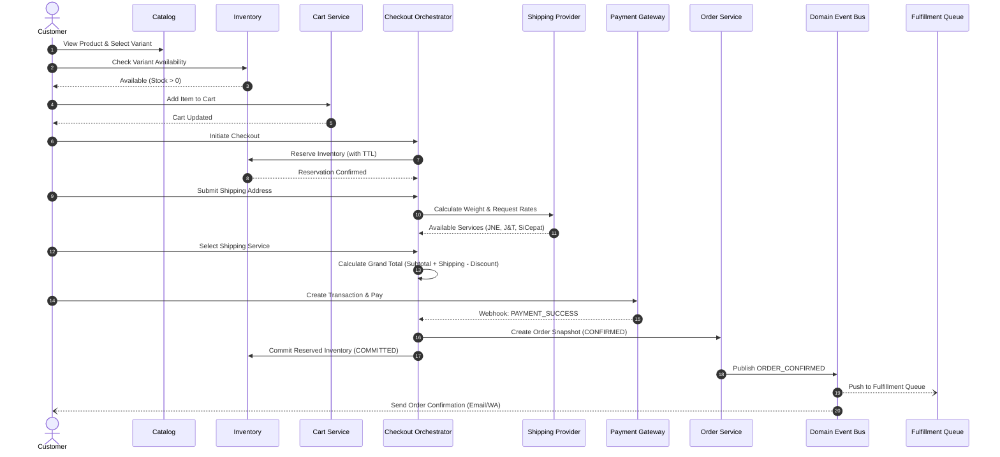

# 03. Orchestration & Event Workflows

## 1. Orchestration Architecture

Domain services communicate via explicit event publication and saga orchestration. The **Checkout & Order Orchestrator** manages the transactional state machine, ensuring distributed operations remain consistent through compensations on failure.

---

## 2. The Happy Path Flow (Customer Purchase Loop)



---

## 3. Failure & Rollback Paths

### 3.1 Payment Failed or Expired Flow

A payment failure or TTL expiry must never corrupt stock levels or erase the user's intent prematurely.

```text
               ┌───────────────────────┐
               │    Checkout Session   │
               │  (Inventory Reserved) │
               └───────────┬───────────┘
                           │
                 Payment Fails / Expires
                           │
                           ▼
               ┌───────────────────────┐
               │  Release Reservation  │
               └───────────┬───────────┘
                           │
            ┌──────────────┴──────────────┐
            ▼                             ▼
┌─────────────────────────┐   ┌─────────────────────────┐
│ Inventory State:        │   │ Cart State:             │
│ Reserved ──> Available  │   │ Preserved & Active      │
│ (Stock restored)        │   │ (User can retry/change) │
└─────────────────────────┘   └─────────────────────────┘
```

#### Invariants for Failure Handling:
1. **Never permanently deduct stock on checkout initiation.** Stock is only moved to `Committed` upon verified payment capture.
2. **Do not destructively flush the Cart.** If payment fails, the user is redirected back to the payment selection or checkout review screen with items preserved.
3. **Automatic Expiry Sweeper**: A background task periodically sweeps and releases expired reservations whose payment TTL has elapsed without webhook receipt.

---

## 4. Asynchronous Fulfillment & Logistics Flow

Payment settlement and physical package dispatch happen at different velocities. Fulfillment is decoupled from order confirmation via an asynchronous queue.

```text
Payment SUCCESS
      │
      ▼
Order CONFIRMED
      │
      ▼
Inventory COMMITTED
      │
      ▼
┌─────────────────────────────────┐
│       Fulfillment Queue         │
└────────────────┬────────────────┘
                 │
                 ▼
┌─────────────────────────────────┐
│   Admin / Warehouse Ops         │
│   1. Pick & Pack Items          │
│   2. Generate Shipping Label    │
└────────────────┬────────────────┘
                 │
                 ▼
┌─────────────────────────────────┐
│   Create Shipment Record        │
│   - Courier: J&T                │
│   - Tracking No: JT123456789    │
│   - Status: PACKED              │
└────────────────┬────────────────┘
                 │ Handed to Courier
                 ▼
┌─────────────────────────────────┐
│   Shipment Status: IN_TRANSIT   │
│   Order Status: SHIPPED         │
└─────────────────────────────────┘
```

---

## 5. Intelligence Layer: Analytics Event Choreography

Analytics **never sits directly in the transactional critical path**. It observes domain events asynchronously as a side-effect. If the analytics pipeline slows down or crashes, transactions continue uninterrupted.

```text
                     CUSTOMER / OPERATIONAL ACTION
                                   │
                                   ▼
                        TRANSACTIONAL SERVICE
                     (Processes Cart, Order, etc.)
                                   │
                                   ├───> [Database Commit]
                                   │
                                   └───> [Emit Domain Event]
                                                │
                                                ▼
                                         DOMAIN EVENT BUS
                                                │
                                    ┌───────────┴───────────┐
                                    │                       │
                                    ▼                       ▼
                           [Operational Queue]     [Analytics Consumer]
                          (Fulfillment/Emails)              │
                                                            ▼
                                                   [Analytics Data Store]
                                                   (Page Views, Drop-offs,
                                                    Conversion Metrics)
```

### Event Tapping Examples

| Domain Event | Transactional Action | Analytics Metric Updated |
| :--- | :--- | :--- |
| `ITEM_ADDED_TO_CART` | Cart database updated with variant & quantity. | Cart Add Rate, Product Interest Index. |
| `CHECKOUT_STARTED` | Inventory reserved, checkout session created. | Checkout Initiation Rate, Funnel Step 2. |
| `SHIPPING_SELECTED` | Shipping rate added to checkout breakdown. | Preferred Courier Distribution, Shipping Cost Ratio. |
| `PAYMENT_SUCCESS` | Order confirmed, inventory committed. | Conversion Rate, GMV, Revenue, AOV. |
| `PAYMENT_FAILED` | Reservation released, cart preserved. | Payment Method Failure Rate, Churn analysis. |

---

## 6. Dashboard Read-Model Projection

The Dashboard is a pure **Read-Model Projection** that aggregates data across Orders, Payments, Inventory, and Customers. It has zero write authority over core transactions.

```text
┌────────────────┐     ┌────────────────┐     ┌────────────────┐     ┌────────────────┐
│  Order Store   │     │ Payment Store  │     │ Inventory Log  │     │ Customer Store │
└───────┬────────┘     └───────┬────────┘     └───────┬────────┘     └───────┬────────┘
        │                      │                      │                      │
        └──────────────────────┼──────────────────────┴──────────────────────┘
                               │
                               ▼
                ┌─────────────────────────────┐
                │  Read-Model Projection View │
                └──────────────┬──────────────┘
                               │
                               ▼
                ┌─────────────────────────────┐
                │      Admin Dashboard        │
                │ ─────────────────────────── │
                │ • Today's Revenue (Rp)      │
                │ • Total Orders & Paid Ratio │
                │ • Average Order Value (AOV) │
                │ • Low Stock Threshold Alerts│
                │ • Sales Trends & Top SKUs   │
                └─────────────────────────────┘
```
