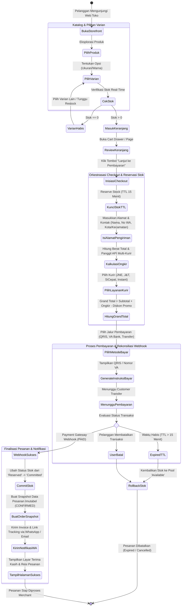
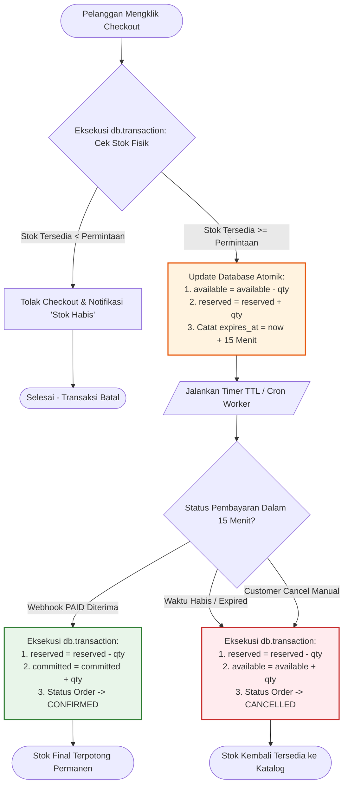
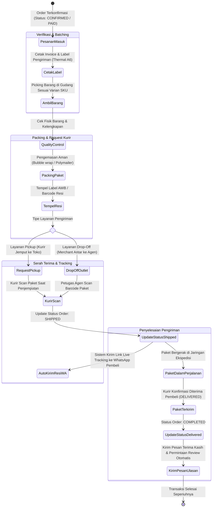
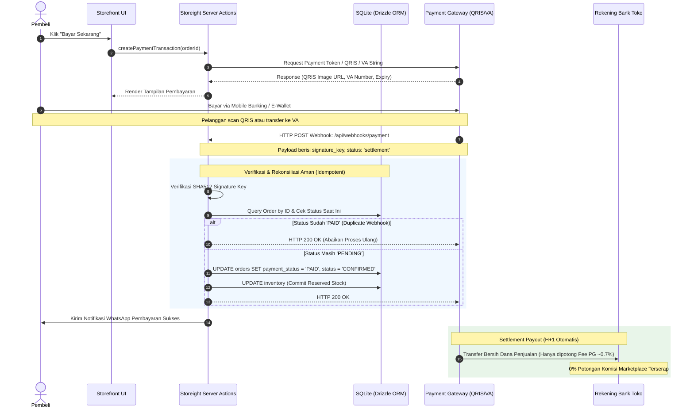
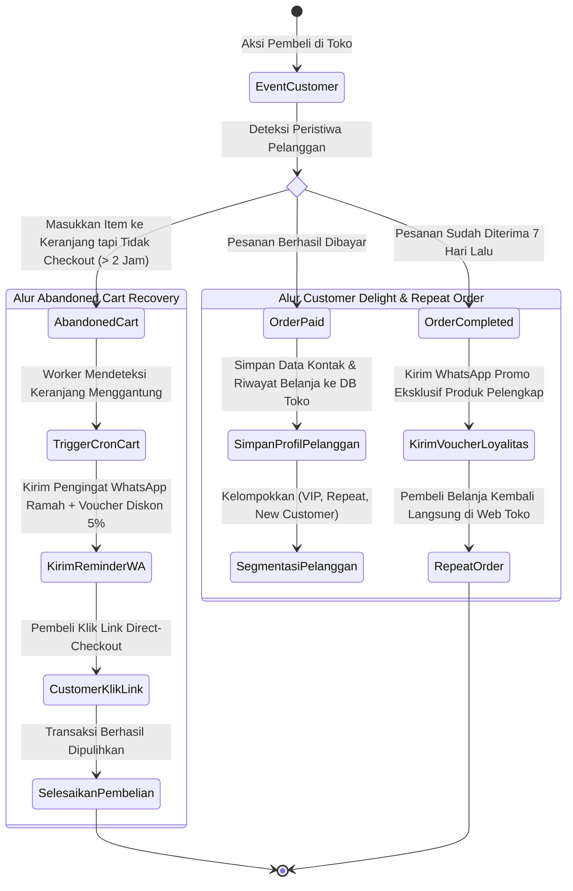
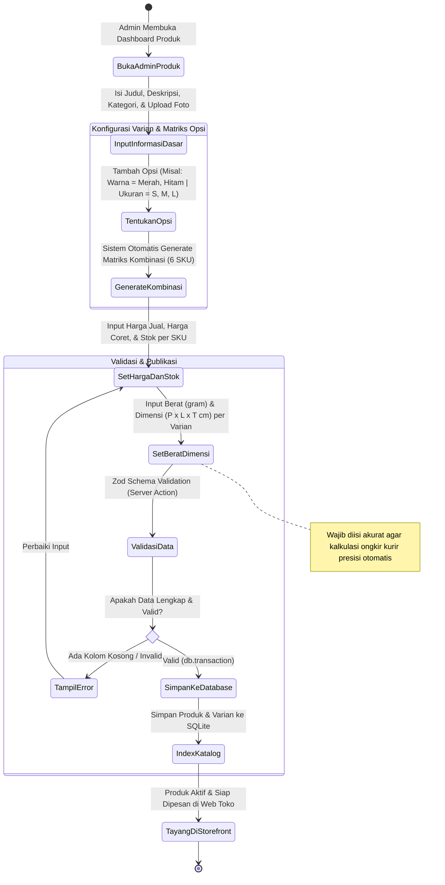

# 06. Activity Diagrams & Independent E-Commerce Operational Workflows

Dokumentasi ini memetakan seluruh **Activity Diagram** operasional sistem **Storeight** (Platform Toko Online Mandiri / Self-Hosted D2C E-Commerce) menggunakan format standar **Mermaid**.

Perancangan ini berfokus pada arsitektur transaksi langsung untuk **menghilangkan biaya komisi/potongan marketplace** (*Marketplace Fee Elimination*), menjaga kedaulatan data pelanggan (*1st-Party Customer Data Ownership*), dan menjamin integritas transaksi melalui *3-Tier Inventory Locking* dan otomatisasi logistik multi-kurir.

---

## 1. Analisis Strategis: Toko Online Mandiri vs Marketplace

```mermaid
graph TD
    subgraph MarketplaceModel [Model Marketplace Konvensional]
        direction TB
        M_Cust[Pelanggan Beli di Marketplace] --> M_Fee[Potongan Biaya Admin 4.5% - 10%]
        M_Cust --> M_ShipFee[Potongan Biaya Gratis Ongkir XTRA 3% - 4.5%]
        M_Cust --> M_Mask[Data Pembeli Disamarkan / Tidak Bisa CRM]
        M_Cust --> M_Escrow[Dana Ditahan di Saldo Marketplace 2-7 Hari]
        M_Cust --> M_Comp[Iklan Toko Kompetitor Muncul di Halaman Produk]
    end

    subgraph StoreightModel [Model Toko Online Mandiri - Storeight]
        direction TB
        S_Cust[Pelanggan Beli di Storeight Storefront] --> S_Direct[0% Biaya Komisi Platform / Marketplace]
        S_Cust --> S_PG[Hanya Biaya Payment Gateway: QRIS 0.7% / VA Flat ~Rp2.000]
        S_Cust --> S_Data[100% Kepemilikan Database Pelanggan & No. WhatsApp]
        S_Cust --> S_Payout[Pencairan Dana Otomatis H+1 Langsung ke Rekening]
        S_Cust --> S_Brand[Eksklusif Brand Sendiri Tanpa Gangguan Kompetitor]
    end

    style MarketplaceModel fill:#ffebee,stroke:#c62828,stroke-width:2px
    style StoreightModel fill:#e8f5e9,stroke:#2e7d32,stroke-width:2px
```

---

## 2. Activity Diagram: End-to-End Customer Purchase & Checkout Loop

Diagram aktivitas lengkap interaksi pembeli dari katalog hingga konfirmasi pesanan berhasil.

---

## 3. Activity Diagram: 3-Tier Inventory Lifecycle & Concurrency Locking

Diagram aktivitas pengelolaan daur hidup stok 3 tingkat (*Available $\rightarrow$ Reserved $\rightarrow$ Committed*) dengan pencegahan *race-condition* dan *overselling* saat lonjakan transaksi (flash sale).

---

## 4. Activity Diagram: Pemenuhan Pesanan Merchant (Fulfillment & Logistics)

Diagram alur kerja merchant/admin dari pesanan terbayar hingga pengiriman paket ke kurir.

---

## 5. Activity Diagram: Pembayaran Langsung & Rekonsiliasi Otomatis (0% Marketplace Fee)

Diagram alur penerimaan uang langsung via Payment Gateway (Midtrans / Xendit / Tripay) dan pencairan saldo (*auto-disbursement*) ke rekening bank toko.

---

## 6. Activity Diagram: CRM 1st-Party & Retensi Pembeli (WhatsApp Automation)

Diagram pemanfaatan data mandiri (*1st-party customer data*) untuk meningkatkan pembelian berulang (*repeat order*) dan pemulihan keranjang tertinggal (*abandoned cart recovery*).

---

## 7. Activity Diagram: Manajemen Produk & Multi-Varian (Merchant Back-Office)

Diagram alur pengelolaan katalog produk, matriks varian otomatis, penentuan berat untuk ongkir otomatis, dan sinkronisasi stok.

---

## 8. Ringkasan Keunggulan Operasional & Finansial Toko Mandiri

| Parameter | Marketplace Pihak Ketiga | Toko Mandiri Storeight | Keuntungan Strategis |
| :--- | :--- | :--- | :--- |
| **Biaya Transaksi / Komisi** | 6.5% - 12.5% per transaksi | 0% biaya platform (hanya PG ~0.7%) | **Penghematan margin bersih 6% - 11% per order** |
| **Biaya Layanan Pembeli** | Rp1.000 - Rp3.000 per transaksi | Rp0 (Gratis untuk pembeli) | Mengurangi friksi checkout pembeli |
| **Pencairan Dana (Disbursement)** | Tertahan 3 - 7 hari di saldo e-commerce | H+1 otomatis ke rekening merchant | Arus kas (*cash flow*) jauh lebih sehat |
| **Kepemilikan Data Pembeli** | Data disamarkan (*masked*), nomor HP disensor | 100% milik toko (Nama, HP, Email, Riwayat) | Aset jangka panjang untuk *remarketing* WhatsApp |
| **Perang Harga & Iklan Kompetitor** | Iklan toko lain muncul di halaman produk sendiri | 100% lingkungan brand eksklusif | Bebas dari perang harga (*price war*) |
| **Ketentuan & Kebijakan Toko** | Terikat aturan penalti & penutupan sepihak | Kendali penuh di tangan pemilik bisnis | Bisnis aman dan berkelanjutan jangka panjang |
