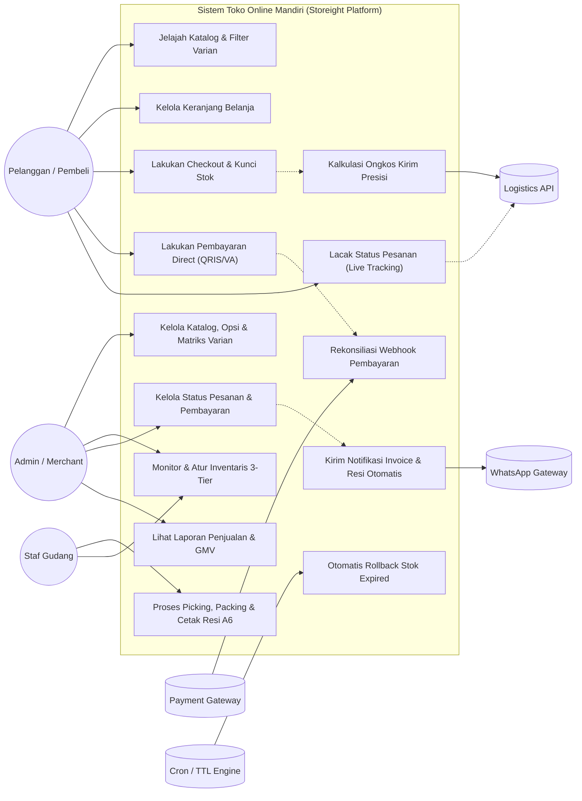
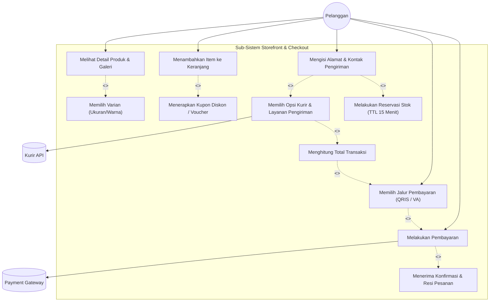
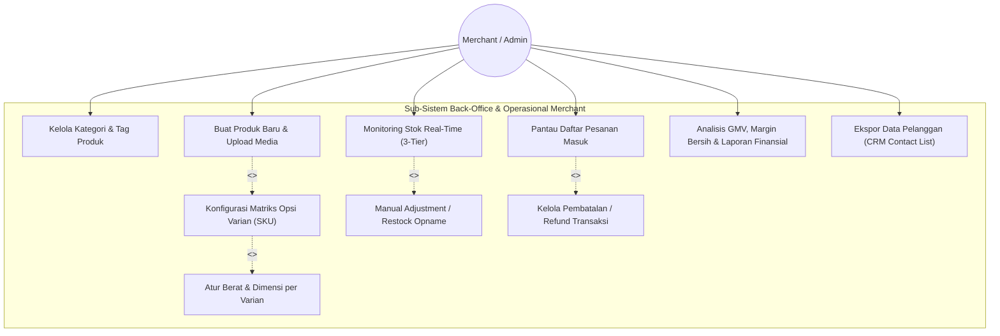
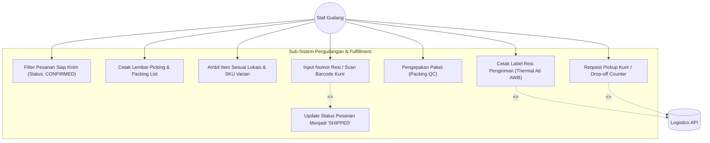
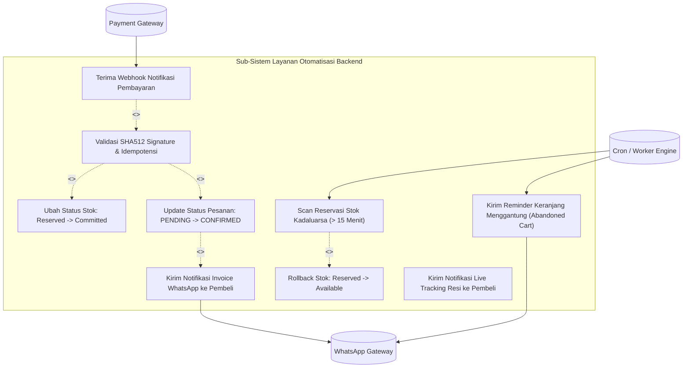

# 07. Use Case Diagrams & Actor Interaction Specifications

Dokumentasi ini memetakan seluruh **Use Case Diagram** sistem **Storeight** (Platform Toko Online Mandiri / Self-Hosted D2C E-Commerce) menggunakan format standar **Mermaid**.

Perancangan use case ini mendefinisikan batas sistem (*system boundary*), aktor utama (*primary actors*), aktor eksternal (*secondary/supporting actors*), serta relasi ketergantungan (`<<include>>` dan `<<extend>>`) untuk seluruh domain fungsional.

---

## 1. Identifikasi Aktor (Actor Catalog)

| Kategori Aktor | Nama Aktor | Deskripsi & Peran |
| :--- | :--- | :--- |
| **Aktor Manusia (Primary)** | **Pelanggan (Customer / Guest / Buyer)** | Pengunjung toko online yang menjelajahi katalog, memilih varian, melakukan reservasi stok, membayar, dan melacak pesanan. |
| | **Admin Toko / Merchant (Store Owner)** | Pemilik atau pengelola bisnis yang mengelola produk, menetapkan matriks varian, memantau pesanan, mengelola stok, dan menganalisis metrik finansial. |
| | **Staf Gudang (Warehouse / Fulfillment Staff)** | Operator logistik internal yang melakukan *picking*, *packing*, pencetakan label resi A6, dan serah terima paket ke ekspedisi. |
| **Aktor Sistem Eksternal (Secondary)** | **Payment Gateway (PG)** | Provider pembayaran (Midtrans, Xendit, Tripay) yang memproses QRIS, Virtual Account, kartu, dan mengirimkan notifikasi status webhook. |
| | **Logistics / Courier API Provider** | Layanan agregator/ekspedisi (Biteship, RajaOngkir, JNE, J&T, SiCepat) untuk penghitungan tarif ongkir real-time dan update pelacakan resi (AWB). |
| | **WhatsApp Gateway / Notification Engine** | Layanan pengiriman pesan WhatsApp otomatis (Fonnte, Waha, Wablas) untuk invoice, link pelacakan pesanan, dan *abandoned cart recovery*. |
| **Aktor Internal Terjadwal** | **TTL Worker / Cron Engine** | Background scheduler yang memeriksa TTL reservasi inventaris dan melepaskan (*release/rollback*) stok yang kadaluarsa secara periodik. |

---

## 2. High-Level Global System Use Case Diagram

Diagram menyeluruh yang menghubungkan seluruh aktor utama dan eksternal ke dalam domain inti Storeight.

---

## 3. Detail Use Case: Domain Storefront & Transaksi Pelanggan

Diagram terperinci interaksi pembeli saat melakukan pemesanan langsung, termasuk relasi `<<include>>` dan `<<extend>>`.

### Spesifikasi Skenario Utama: Checkout & Reservasi
- **Aktor Utama**: Pelanggan
- **Pra-kondisi**: Pelanggan memiliki minimal 1 item di keranjang belanja.
- **Alur Normal**:
  1. Pelanggan membuka halaman checkout.
  2. Sistem memicu `UC_8: Reservasi Stok` untuk mengunci kuantitas varian selama TTL 15 menit.
  3. Pelanggan memasukkan data nama, nomor WhatsApp aktif, dan alamat lengkap.
  4. Sistem memanggil `Courier API` untuk mengambil opsi layanan dan tarif berdasarkan total berat item.
  5. Pelanggan memilih metode pembayaran (QRIS/VA).
  6. Pelanggan menyelesaikan pembayaran; status pesanan berubah menjadi `CONFIRMED`.
- **Ekstensi (Alur Alternatif)**:
  - *4a. Kupon Promo Diterapkan*: Jika kupon valid, kurangi subtotal sebelum penambahan ongkos kirim.
  - *2a. Stok Tidak Cukup*: Sistem membatalkan transaksi dan menampilkan notifikasi varian habis.

---

## 4. Detail Use Case: Domain Manajemen Operasional & Admin Toko

Diagram alur kerja pengelolaan merchant untuk katalog, stok, dan laporan keuangan.

---

## 5. Detail Use Case: Domain Pergudangan & Logistik (Fulfillment)

Diagram aktivitas pemenuhan pesanan dari gudang ke tangan kurir.

---

## 6. Detail Use Case: Integrasi Sistem Eksternal & Otomatisasi (Background Services)

Diagram use case untuk proses otomatisasi backend tanpa keterlibatan manual manusia.

---

## 7. Matriks Hubungan Aktor dan Use Case (Traceability Matrix)

| Use Case ID | Nama Use Case | Primary Actor | Supporting Actor | Ketergantungan (`include`/`extend`) |
| :--- | :--- | :--- | :--- | :--- |
| **UC-01** | Cari & Filter Katalog Produk | Pelanggan | - | - |
| **UC-02** | Pilih Opsi & Varian SKU | Pelanggan | - | `<<include>>` UC-01 |
| **UC-03** | Reservasi Stok 15 Menit (TTL) | Sistem (Checkout) | SQLite Engine | `<<include>>` UC-04 |
| **UC-04** | Inisiasi Checkout & Isi Alamat | Pelanggan | Logistics API | `<<include>>` UC-05 |
| **UC-05** | Hitung Ongkir Multi-Kurir | Sistem | Logistics API | `<<include>>` UC-04 |
| **UC-06** | Bayar via QRIS / VA | Pelanggan | Payment Gateway | `<<include>>` UC-07 |
| **UC-07** | Rekonsiliasi Webhook Pembayaran | Payment Gateway | SQLite Engine | `<<include>>` UC-08, UC-09 |
| **UC-08** | Commit Stok Terjual | Sistem | SQLite Engine | `<<include>>` UC-07 |
| **UC-09** | Kirim Notifikasi WhatsApp | Sistem | WhatsApp Gateway | - |
| **UC-10** | Rollback Stok Kadaluarsa | Cron Engine | SQLite Engine | - |
| **UC-11** | Buat Matriks Varian Produk | Merchant / Admin | - | `<<include>>` UC-12 |
| **UC-12** | Input Berat & Dimensi Varian | Merchant / Admin | - | `<<include>>` UC-11 |
| **UC-13** | Cetak Resi Pengiriman A6 | Staf Gudang | Logistics API | - |
| **UC-14** | Request Pickup / Drop-Off Kurir | Staf Gudang | Logistics API | `<<include>>` UC-15 |
| **UC-15** | Update Status Pesanan SHIPPED | Staf Gudang | WhatsApp Gateway | `<<include>>` UC-09 |
| **UC-16** | Analisis GMV & Finansial | Merchant / Admin | - | - |
| **UC-17** | Recovery Abandoned Cart | Cron Engine | WhatsApp Gateway | - |
